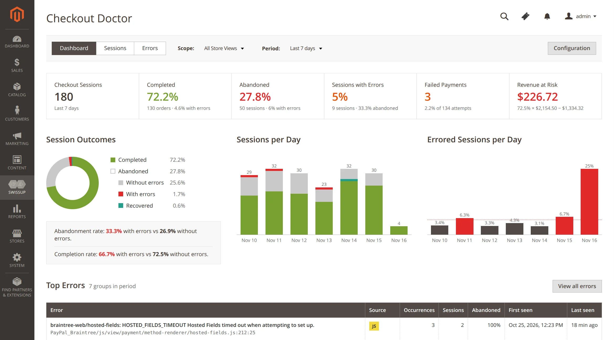
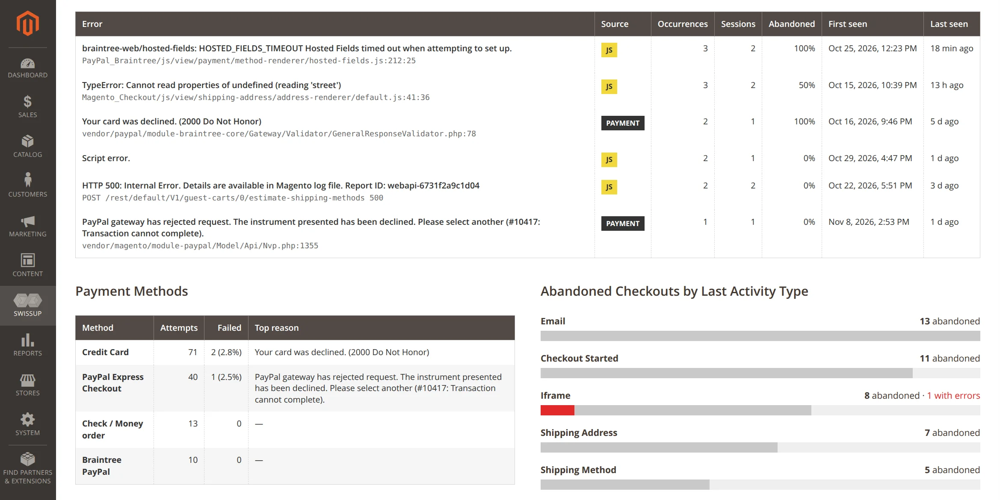
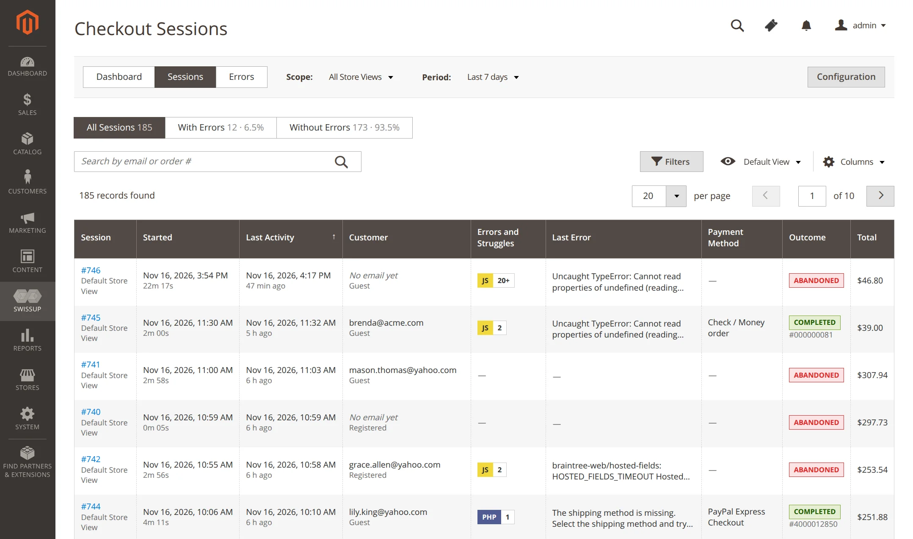
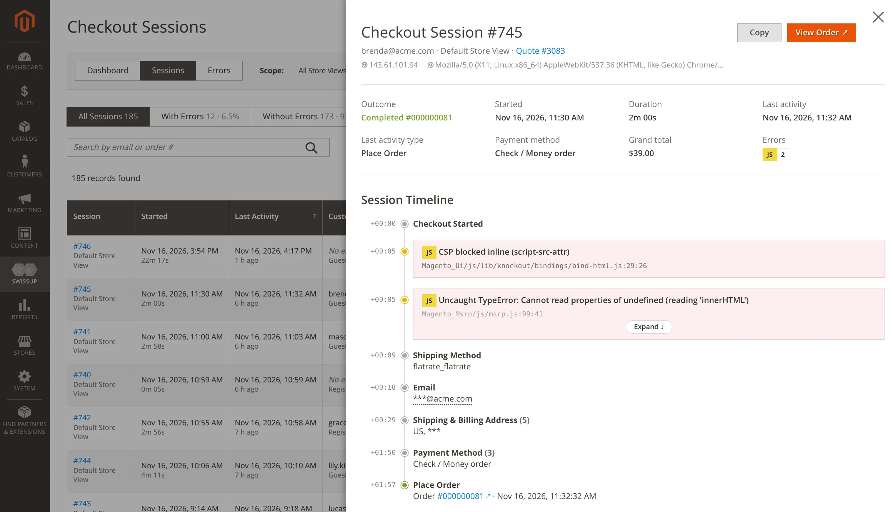
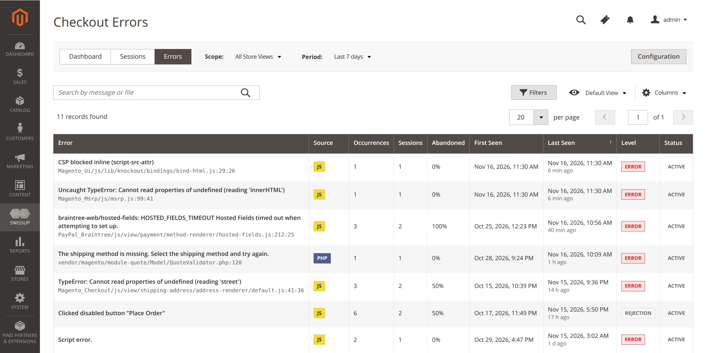
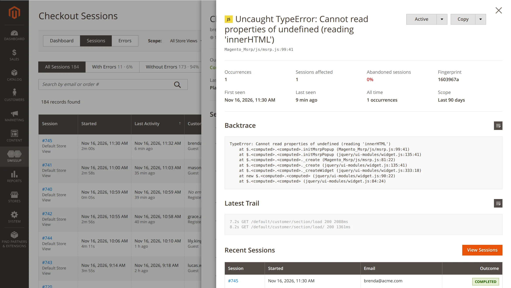
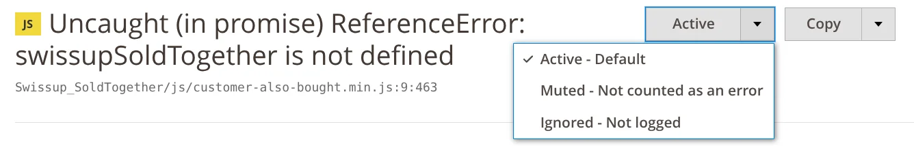

# Backend Pages

Checkout Doctor provides 3 pages to analyze and review checkout sessions and errors.
Open them at _Swissup > Checkout > Checkout Doctor_.

All pages share _Scope_ and _Period_ filters.

### Contents

 1. [Dashboard](#dashboard)
 2. [Sessions](#sessions)
    - [Session outcome](#session-outcome)
    - [Timeline](#timeline)
    - [Iframes and popups](#iframes-and-popups)
 3. [Errors](#errors)
    - [Error source](#error-source)
    - [Error level](#error-level)
    - [Backtrace and trail](#backtrace-and-trail)
    - [Error status](#error-status)

## Dashboard

The dashboard counts finished sessions only: completed or abandoned.
Sessions in progress are left out: you can see them only on the
[Sessions](#sessions) page.

The top row shows key numbers. Click a card to open the matching sessions or errors.

Card                 | Shows
:--------------------|:-----
Checkout Sessions    | Number of finished sessions in the period.
Completed            | Share of sessions that ended with an order.
Abandoned            | Share of sessions left without an order, and how many were recovered later.
Sessions with Errors | Share of sessions that hit an [error](#errors), and how many of them were abandoned.
Failed Payments      | Declined payments out of all _Place Order_ attempts.
Revenue at Risk      | Money lost to checkout problems. See below.

**Revenue at Risk** answers: how much more would we earn if sessions with
problems completed as often as sessions without them?

It takes the cart total of sessions with [errors or struggles](#error-level), multiplies it by
the completion rate of clean sessions, and subtracts what those errored sessions
actually earned.

You can also review the top issues at checkout page:

Section                    | Shows
:--------------------------|:-----
Top Errors                 | The most frequent errors in the period. See the [Errors](#errors) section.
Payment Methods            | Attempts and failures per payment method, with the top decline reason.
Abandoned Checkouts by Last Activity Type | The last step customers made before leaving. See [Timeline](#timeline).

## Sessions

A customer opens the checkout page. Checkout Doctor starts a **session**: one
attempt to place an order with this cart.

The session has three possible outcomes: completed, abandoned, and recovered.

When the session has no activity for _Abandon Session After_ minutes (30 by default),
it is marked **abandoned**. If the same customer or cart places an order later,
the old session remains abandoned but with **recovered** badge.

Checkout doctor let's you see all sessions in a grid, open a session to see
its timeline, and review the steps the customer made. Additionally, when
timeline has an error, you can click it to see the backtrace and trail
of customer actions:

### Timeline

Click a session to see its timeline: the steps the customer made, in order.

You can also use a "Copy" button to share the anonymized timeline with
a developer or AI agent.

A step is recorded only when its data changes. Repeating a step with the same
data adds nothing.

Event              | Meaning
:------------------|:-------
Checkout Started   | The checkout page was opened.
Email              | The customer entered email.
Login              | The customer signed in at checkout.
Shipping Address   | Shipping address changed.
Shipping Method    | Shipping method changed.
Billing Address    | Billing address changed.
Payment Method     | Payment method changed.
Place Order        | The customer clicked _Place Order_.
Iframe             | The customer clicked into a payment iframe. See [below](#iframes-and-popups).
Popup              | The page opened a window to another site. Most of popups still registered as Iframe.
Rage Click         | 3 or more fast clicks on the same element. Marks the session as [struggled](#error-level).
Disabled Click     | A click on a disabled button, for example _Place Order_ before the form is valid. Recorded as a [rejection](#error-level).
Error              | Something went wrong. See [Errors](#errors).

The last event before the customer left is the session's _last activity type_.
The dashboard groups abandoned checkouts by it, so you see where customers leave.

### Iframes and popups

Card fields, PayPal and other payment buttons live in iframes from another site.
The browser hides what happens inside them. Checkout Doctor sees only the moment
the customer clicks into the iframe, and records it as an **Iframe** event.

If the session is abandoned right after an Iframe event, the customer most likely
had trouble with that payment form.

When the page opens a window to another site, a **Popup** event is recorded.
Most payment popups, like PayPal, are opened from inside the payment iframe,
so the page can't see them. They are still logged as **Iframe** events.

## Errors

Identical errors are shared between sessions: same source, message and file.

### Error source

Source  | What is captured
:-------|:----------------
JS      | Errors in the browser on the checkout page: script errors, `console.error` calls, failed requests, blocked scripts (CSP).
PHP     | Server errors logged during checkout, failed order submits.
Payment | Declined payments: at _Place Order_, or later from the payment provider (IPN, webhook).

### Error level

Not every error is a bug. We also track form submission mistakes as **rejection** error.

Level     | Meaning                                                  | Example
:---------|:---------------------------------------------------------|:-------
Error     | Something is broken. The session is marked **with errors**. | JS exception, HTTP 500, declined card.
Rejection | The store refused what the customer did. The session is marked **struggled**. | Invalid coupon, wrong password, click on disabled _Place Order_ button.

Multiple fast clicks on the same element (Rage clicks) also marks the session
as struggled.

### Backtrace and trail

Click an error in the grid or in a session timeline to see what led to it.

Term      | Meaning
:---------|:-------
Backtrace | The code path where the error happened.
Trail     | The last activity in browser before the error: clicks, field changes, checkout steps and requests.

Use _Copy_ or _Copy with trail_ to share the error with a developer or AI agent.
_View Sessions_ shows all sessions with this error.

### Error status

Some errors are known and harmless. Change the error status to hide the noise:

Status  | Effect
:-------|:------
Active  | Default. The error is shown and counted.
Muted   | Shown dimmed in the timeline, not counted in statistics, not treated as an error.
Ignored | New occurrences are not added to session timelines. Only _Last seen_ and the _All time_ counter on the error page are updated. Existing timeline entries are kept, dimmed and not counted.

Changing the status recounts every session with this error.
