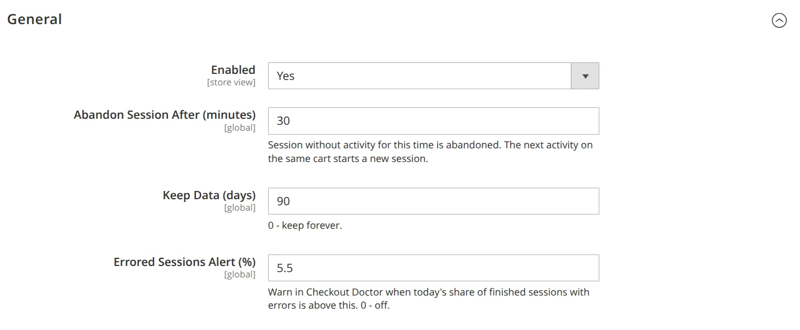

# Configuration

Module configuration is available at _Stores > Configuration > Swissup Checkout > Checkout Doctor_.

Option                         | Description
:------------------------------|:-----------
Enabled                        | Enable or disable checkout tracking.
Abandon Session After (minutes)| Session without activity for this time is abandoned. The next activity on the same cart starts a new session. Default: 30.
Keep Data (days)               | Sessions and errors older than this are removed by cron. `0` - keep forever. Default: 90.
Errored Sessions Alert (%)     | Show "Checkout needs attention" alert in the admin when today's share of finished sessions with errors is above this value. `0` - off. Default: 5.5.
