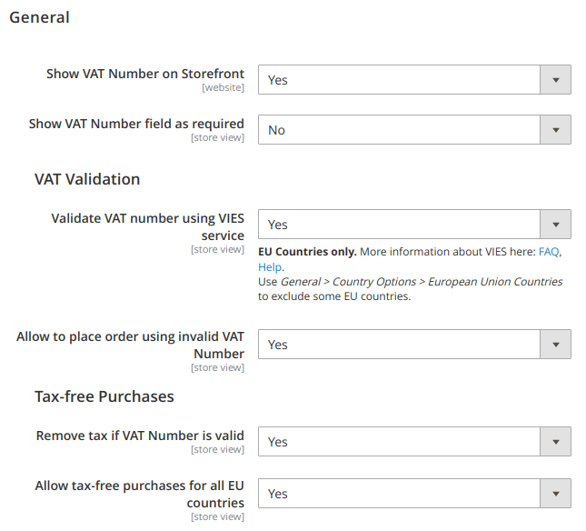
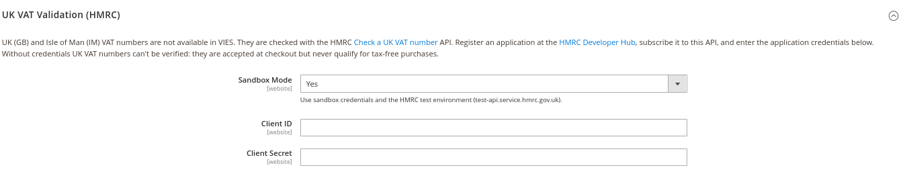

# Configuration

### General section

Option              | Description
--------------------|-----------------------------------------------
Show VAT Number on Storefront | Enable/Disable VAT Number field
Show VAT field as required | Require non-empty VAT field value during checkout
**VAT Validation** |
Validate VAT number using VIES service | Enable/Disable VAT validation
Allow to place order using invalid VAT Number | Allow or block order placement when VAT is invalid
**Tax-free Purchases** |
Remove tax if VAT Number is valid | Set the tax to zero when VAT is valid
Allow tax-free purchases for all EU countries | Ability to limit countries that are applicable for tax-free purchases
TAX-free applicable EU countries | Select which coutries from EU applicable for tax-free purchases

> **Important:** *Stores > Configuration > General > General > Country Options >
> European Union Countries* must list EU member states only. Remove the United
> Kingdom if it is selected (it was in the default list before Brexit and often
> remains in old configurations). Otherwise UK VAT numbers are sent to VIES and
> fail with "Invalid_input". UK numbers are validated with HMRC, see below.

### UK VAT Validation (HMRC)

UK (GB) and Isle of Man (IM) VAT numbers are not available in VIES. Since
version 1.4.11 they are checked with the HMRC
[Check a UK VAT number API v2](https://developer.service.hmrc.gov.uk/api-documentation/docs/api/service/vat-registered-companies-api/2.0),
which requires application credentials.

Option              | Description
--------------------|-----------------------------------------------
Sandbox Mode | Use sandbox credentials and the HMRC test environment
Client ID | Client ID of your HMRC application
Client Secret | Client Secret of your HMRC application. It is stored encrypted.

Both credentials are marked as sensitive, so they are not exported by
`bin/magento app:config:dump`.

#### How to get HMRC credentials

 1. Register at the [HMRC Developer Hub](https://developer.service.hmrc.gov.uk)
    and create an application. Sandbox credentials are issued immediately,
    production credentials after HMRC approval (about 2 weeks).
 2. Subscribe the application to **Check a UK VAT number**, version **2.0**.
 3. Copy the Client ID and generate a Client Secret.
 4. Enter them at *Stores > Configuration > Swissup Checkout > Tax VAT >
    UK VAT Validation (HMRC)*. Enable *Sandbox Mode* if you use sandbox
    credentials.

In sandbox mode only HMRC
[test VAT numbers](https://github.com/hmrc/vat-registered-companies-api/blob/master/public/api/conf/2.0/test-data/vrn.csv)
are recognised, for example `GB553557881`.

#### Validation result at checkout

Situation | Result
----------|-------
VAT number is registered | Accepted
VAT number is not registered | Rejected
Not 9 or 12 digits after the GB/IM prefix | Rejected, HMRC is not called
No credentials, or HMRC is unavailable | Accepted, but never tax-free

#### Troubleshooting

Failed HMRC requests are logged to `var/log/system.log` with the
`Swissup Taxvat:` prefix. For example, `token request failed: HTTP 401
invalid_client` means wrong credentials, or sandbox credentials used with
*Sandbox Mode* disabled (or the opposite).

### Stores outside the EU

Magento's *Automatic Assignment to Customer Group* sends the store VAT number
(*Stores > Configuration > General > Store Information > VAT Number*) to VIES
as the requester. When the store country is not in the *European Union
Countries* list (for example, a UK store), Magento skips the check completely.

Since version 1.4.11 the module drops such requester from every VIES request.
The customer VAT number is still validated, but VIES returns no consultation
number (it issues them to EU requesters only). The store VAT number can stay
in the store information, emails and invoices.

#### Next up

 -  [Back to Main Page](/m2/extensions/taxvat/)
